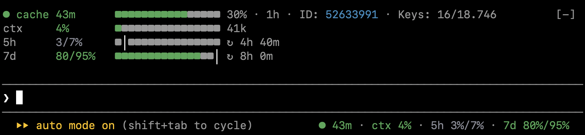
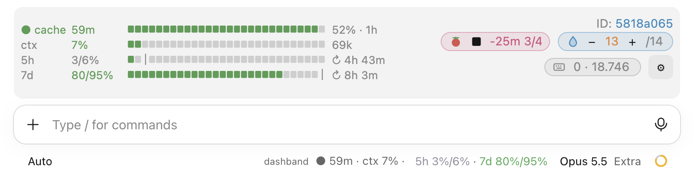
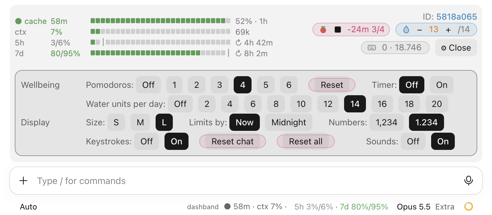

# dashband

A [Claude Code](https://code.claude.com) mod that shows the prompt cache, the context window and
your plan limits at a glance: in the prompt footer, and as a band with bars above the prompt.
In the Desktop app it can also keep you going at a healthy pace: pomodoros or a timer, water and
keystrokes, each turned on in the settings.

In the terminal:



In the Code tab of the Claude Desktop app:



As text, the footer:

```
● 42m · ctx 31% · 5h 12%/40% · 7d 70%/96%
```

and the band in the terminal:

```
● cache 42m      ■■■■■■■■■■■□□□□□ 100% · 1h · ID: 46b74c3d
ctx     31%      ■■■■■□□□□□□□□□□□ 310k
5h      12/40%   ■■□□□□│□□□□□□□□□ ↻ 3h 0m
7d      70/96%   ■■■■■■■■■■■□□□□│ ↻ 7h 0m
```

The Desktop app draws the band as a small graphic with finer bars, and on the right the session
id, the pills you turned on and a **⚙** button for the settings. Each row shows its details as a
tooltip.

## Why

Claude Code caches the beginning of each request. Reading from the cache is much cheaper than
processing the context again. Once the cache expires, the next request has to write the whole
context to the cache again, which is most expensive in long sessions. dashband tells you how much
time is left before that happens, how full the context is, and whether your plan limits last
until they reset.

## What it shows

| Item | Meaning |
|---|---|
| `● 42m` | Time left until the prompt cache expires: green while more than 2 minutes are left, yellow in the last 2 minutes, gray `cold` once expired, `hot` while Claude is working |
| `100%` (band) | Share of the last response's input tokens read from the cache; then the cache lifetime |
| `ctx 31%` | How full the context window is: green, orange from 75 %, red from 90 % |
| `5h 12%/40%` | Five-hour limit: used, and where usage would be by now if spread evenly over the window |
| `↻ 3h 0m` (band) | Time until the limit resets |
| `ID: 46b74c3d` (band) | The first eight characters of the session id, to tell chats apart |
| `7d 70%/96%` | 7-day limit, the same way |
| `Keys: 1,234/8,412` (band) | Keystrokes in this chat and today across all chats; only when turned on in the settings. The Desktop app shows them as a pill |
| Pomodoro, timer, water (Desktop app) | Pills beside the session id; only when turned on in the settings, see [Wellbeing](#wellbeing) |

The limits are colored by pace, used minus expected:

| Color | Pace |
|---|---|
| green | 10 points or more below |
| gray | about on pace |
| orange | up to 15 points above |
| red | more than 15 points above, or the limit is used up |

In the terminal, the footer shows everything as one colored item. The Desktop app cuts a footer
item short, so there cache and context appear in the status line, which the app labels with the
mod's name and draws without colors, and the limits follow as a colored item. The band adds a bar
for each item. On the limit bars, `│` marks where usage would be by now.
Two minutes before the cache expires, the cache turns yellow and a notice stays for a minute,
naming the session and saying how many tokens the next request would write again.

## Settings

In the Desktop app, **⚙** beside the band opens the settings below it, **⚙ Close** closes them.
A choice applies at once, to every chat.



| Setting | Choices |
|---|---|
| Size | `S`, `M`, `L`: the size of the band |
| Limits expected by | `Now`: where usage would be by now. `Midnight`: where it may be at the end of the day (local time), or at the reset if that comes first |
| Pomodoros | `Off` (default) or 1 to 6 blocks in a series. `Reset` starts the series over. Picking a number turns the timer off |
| Timer | `Off` (default) or `On`: a countdown instead of the pomodoros. Turning it on turns the pomodoros off |
| Water units per day | `Off` (default) or 2 to 20 in steps of 2 |
| Numbers | `1,234` or `1.234`: the thousands separator |
| Keystrokes | `Off` (default) or `On`: count your keystrokes in the prompt box, see below. `Reset chat` sets this chat's count to 0, `Reset all` today's count and every chat's |
| Sounds | `Off` or `On` (default): a gong when a pomodoro block, its break or the timer ends |

The cache lifetime, five minutes or one hour, is read from the session transcript. The plan
limits appear only on a Claude subscription.

## Requirements

- Claude Code with mod support (2.1.287 or later); tested with Claude Code 2.1.295 in the
  terminal and the Claude Desktop app
- The terminal (CLI) or the Code tab of the Claude Desktop app. Mods do not draw in the
  VS Code extension, on mobile, or in `claude -p`.
- macOS or Linux for the cache lifetime: dashband reads the transcript with `sh` and `tail`.
  Elsewhere it assumes one hour.

## Installation

dashband is listed in the `egonleitner` marketplace.

### Claude Desktop app

1. Open **Settings > Plugins**. On macOS, choose **Claude > Settings** in the menu bar.
2. Click **+ Add marketplace**, then **Add from a repository**.
3. Enter `EgonLeitner/claude-code-mods` as the URL and click **Sync**. The marketplace shows
   Dashband.
4. Click **Add**. The app confirms that Dashband is installed and ready to use.

### Terminal

```bash
claude plugin marketplace add EgonLeitner/claude-code-mods
claude plugin install dashband@egonleitner
```

Run `/reload-plugins` in an open session, or start a new one.

### Without a marketplace

Load the folder directly for one session:

```bash
claude --plugin-dir /path/to/dashband
```

To load it in every session, including the Desktop app, add the folder to `env` in
`~/.claude/settings.json`:

```json
{
  "env": {
    "CLAUDE_CODE_PLUGIN_DIRS": "/path/to/dashband"
  }
}
```

## Keystrokes

Off by default. Turned on, dashband counts what you type into Claude's prompt box and shows it
under the session id: this chat, and today across all chats. The day starts over at midnight (local
time) or with `Reset all` in the settings, and every chat's count with it. The terminal shows it
after the session id.

To count, dashband watches each edit of the prompt box. **It keeps only numbers, never the text,
and sends nothing anywhere.** It sees the prompt box only, no other app. The code is in
[`hooks/register.tsx`](hooks/register.tsx) and [`hooks/model.ts`](hooks/model.ts).

- Each typed character counts, a deletion counts once, cursor moves do not count.
- Pasted text does not count. Claude Code reports a paste without the key that made it, as it
  does a quick burst of keys; more than 16 characters at once count as a paste.
- In the Desktop app the first message of a new chat does not count: the app starts Claude Code
  for a chat only once that message is sent.
- Counts reach the band every 10 seconds and when you send a prompt.

## Wellbeing

In the Desktop app, pills beside the session id help you keep a healthy pace. Each is off by
default and turned on in the settings. They are shared by all chats; the pomodoro and water
counts start over at midnight (local time). Hover over a pill for details. The terminal does not
show them.

**Pomodoros.** Blocks of 25 minutes, each followed by a 5-minute break, the last of the series by
a 15-minute one. Press ▶ to start the next block, ■ to stop it; a started block counts. A gong and
a notice mark the end of each block and break. Turning the pomodoros off stops a running block.

**Timer.** Shown instead of the pomodoros: `− ▶ + -25:00 /25 ↺`. `−` and `+` change the time by
5 minutes, from 5 to 120, and the time left with it. ▶ starts, ■ pauses, ↺ sets it back to its full
time. At zero a gong and a notice say it is done, and it waits again at its full time. Turning the
timer off pauses it. It keeps its time for the next start, also in other chats. While it runs, the
band redraws every second.

**Water.** Press `+` for each unit you drink, `−` to take one back. The day's target is spread
evenly from 7:00 to 21:00: the count is green on target, orange one unit behind and red two behind,
and a notice reminds you when it turns red.

## Limitations

- The countdown estimates expiry from the time of the last response. It cannot see the cache on
  the server.
- **Desktop app: a new chat shows dashband once you have sent the first message in it.** The app
  starts Claude Code for a chat only then. A chat with an existing conversation shows it shortly
  after you open it, also after an app start; one that waits for your answer to a question
  shows it once you have answered.
- Settings are available in the Desktop app only; the terminal draws the band as text and
  follows what was set there.

Older versions of the Desktop app drew the band in only one chat at a time
([anthropics/claude-code#99265](https://github.com/anthropics/claude-code/issues/99265), fixed
in October 2026).

## Development

```bash
claude plugin validate .
claude plugin test .
```

`tsconfig.json` extends the type declarations Claude Code writes to `.claude-plugin/types/` when
it loads the mod. That folder is not part of the repository; load the mod once to create it.

To trace what dashband receives and draws, create `/tmp/dashband-trace`. Each session then
writes a log there; remove the folder to stop.

Built with the help of Claude Code.

## License

[MIT](LICENSE)
