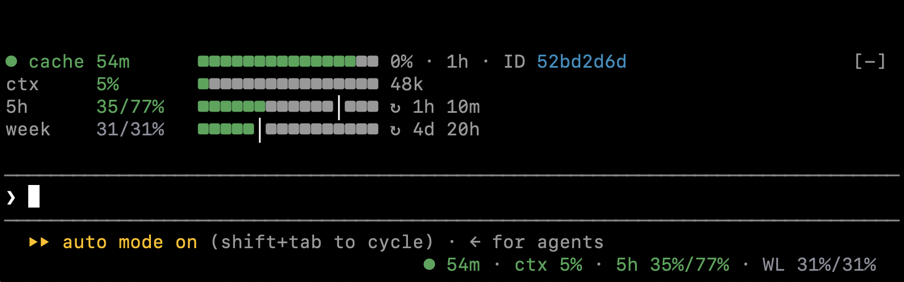
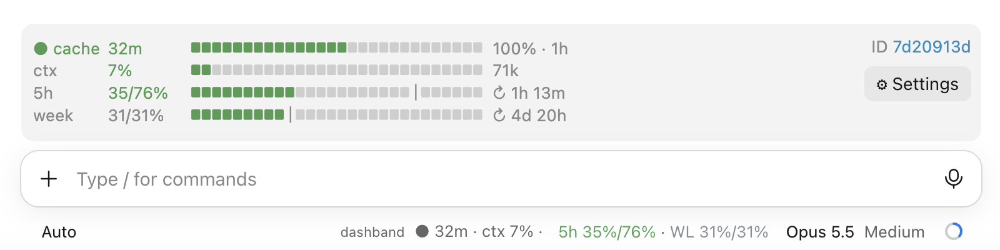
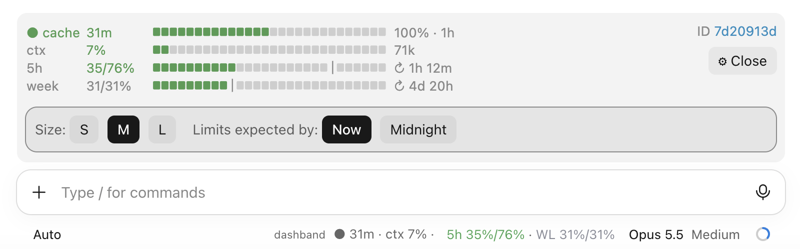

# dashband

A [Claude Code](https://code.claude.com) mod that shows the prompt cache, the context window and
your plan limits at a glance: in the prompt footer, and as a band with bars above the prompt.

In the terminal:



In the Code tab of the Claude Desktop app:



As text, the footer:

```
● 42m · ctx 31% · 5h 12%/40% · WL 70%/96%
```

and the band in the terminal:

```
● cache 42m      ■■■■■■■■■■■□□□□□ 100% · 1h · ID 46b74c3d
ctx     31%      ■■■■■□□□□□□□□□□□ 310k
5h      12/40%   ■■□□□□│□□□□□□□□□ ↻ 3h 0m
week    70/96%   ■■■■■■■■■■■□□□□│ ↻ 7h 0m
```

The Desktop app draws the band as a small graphic with finer bars, the session id and a
**Settings** button on the right. Each row shows its details as a tooltip.

## Why

Claude Code caches the beginning of each request. Reading from the cache is much cheaper than
processing the context again. Once the cache expires, the next request has to write the whole
context to the cache again, which is most expensive in long sessions. dashband tells you how much
time is left before that happens, how full the context is, and whether your plan limits last
until they reset.

## What it shows

| Item | Meaning |
|---|---|
| `● 42m` | Time left until the prompt cache expires: green while more than 2 minutes are left, yellow in the last 2 minutes, gray `cold` once expired, `hot` while Claude is working |
| `100%` (band) | Share of the last response's input tokens read from the cache; then the cache lifetime |
| `ctx 31%` | How full the context window is: green, orange from 75 %, red from 90 % |
| `5h 12%/40%` | Five-hour limit: used, and where usage would be by now if spread evenly over the window |
| `↻ 3h 0m` (band) | Time until the limit resets |
| `ID 46b74c3d` (band) | The first eight characters of the session id, to tell chats apart |
| `WL 70%/96%` | Weekly limit, the same way |

The limits are colored by pace, used minus expected:

| Color | Pace |
|---|---|
| green | 10 points or more below |
| gray | about on pace |
| orange | up to 15 points above |
| red | more than 15 points above, or the limit is used up |

In the terminal, the footer shows everything as one colored item. The Desktop app cuts a footer
item short, so there cache and context appear in the status line, which the app labels with the
mod's name and draws without colors, and the limits follow as a colored item. The band adds a bar
for each item. On the limit bars, `│` marks where usage would be by now.
Two minutes before the cache expires, the cache turns yellow and a notice stays for a minute,
naming the session and saying how many tokens the next request would write again.

## Settings

In the Desktop app, **⚙ Settings** beside the band opens the settings below it. They apply to
every chat.



| Setting | Choices |
|---|---|
| Size | `S`, `M`, `L`: the size of the band |
| Limits expected by | `Now`: where usage would be by now. `Midnight`: where it may be at the end of the day (local time), or at the reset if that comes first |

The cache lifetime, five minutes or one hour, is read from the session transcript. The plan
limits appear only on a Claude subscription.

## Requirements

- Claude Code with mod support (2.1.287 or later); tested with Claude Code 2.1.295 in the
  terminal and the Claude Desktop app
- The terminal (CLI) or the Code tab of the Claude Desktop app. Mods do not draw in the
  VS Code extension, on mobile, or in `claude -p`.
- macOS or Linux for the cache lifetime: dashband reads the transcript with `sh` and `tail`.
  Elsewhere it assumes one hour.

## Installation

dashband is listed in the `egonleitner` marketplace.

### Claude Desktop app

1. Open **Settings > Plugins**. On macOS, choose **Claude > Settings** in the menu bar.
2. Click **+ Add marketplace**, then **Add from a repository**.
3. Enter `EgonLeitner/claude-code-mods` as the URL and click **Sync**. The marketplace shows
   Dashband.
4. Click **Add**. The app confirms that Dashband is installed and ready to use.

### Terminal

```bash
claude plugin marketplace add EgonLeitner/claude-code-mods
claude plugin install dashband@egonleitner
```

Run `/reload-plugins` in an open session, or start a new one.

### Without a marketplace

Load the folder directly for one session:

```bash
claude --plugin-dir /path/to/dashband
```

To load it in every session, including the Desktop app, add the folder to `env` in
`~/.claude/settings.json`:

```json
{
  "env": {
    "CLAUDE_CODE_PLUGIN_DIRS": "/path/to/dashband"
  }
}
```

## Limitations

- The countdown estimates expiry from the time of the last response. It cannot see the cache on
  the server.
- **Desktop app: a new chat shows dashband once you have sent the first message in it.** The app
  starts Claude Code for a chat only then. A chat with an existing conversation shows it shortly
  after you open it, also after an app start; one that waits for your answer to a question
  shows it once you have answered.
- Settings are available in the Desktop app only; the terminal draws the band as text.

Older versions of the Desktop app drew the band in only one chat at a time
([anthropics/claude-code#99265](https://github.com/anthropics/claude-code/issues/99265), fixed
in October 2026).

## Development

```bash
claude plugin validate .
claude plugin test .
```

`tsconfig.json` extends the type declarations Claude Code writes to `.claude-plugin/types/` when
it loads the mod. That folder is not part of the repository; load the mod once to create it.

To trace what dashband receives and draws, create `/tmp/dashband-trace`. Each session then
writes a log there; remove the folder to stop.

Built with the help of Claude Code.

## License

[MIT](LICENSE)
